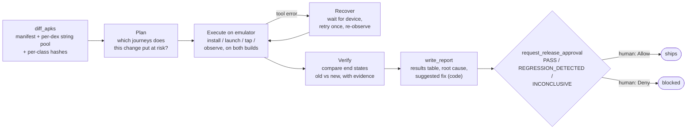
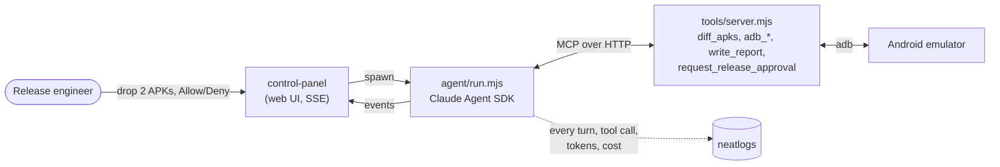

# release-gate-agent

**An autonomous Android release agent that tests what actually shipped.** Give it the
currently-shipped `old.apk` and the release-candidate `new.apk`. It diffs the *compiled*
binaries, decides which user journeys that change puts at risk, drives a real Android emulator
through those journeys on both builds, writes an evidence-backed report with a code-level fix,
and then **stops at a human release gate**: the release does not ship until a person clicks
Allow.

Built for [neatHack](https://neatlogs.com/hackathon) (Oct 10–12, 2026). #neatHack

## Why

Release testing today either crawls the UI blindly (Robo-style crawlers), or reads the source/PR
diff to decide what to test. Neither one looks at what actually ships. Compiled output can
drift from source (build flags, R8/ProGuard, multi-module merges), and source-diff tools don't
work at all for the people who most often sign off a build: QA and release engineers who were
handed an APK. Diffing the compiled build doesn't have either problem.

The bugs that matter most are the quiet ones. Both demo scenarios are real-world classes of
regression that **don't crash and don't throw**: a SharedPreferences rename without a migration
silently logs every existing user out (scenario 1) or deletes their saved notes (scenario 2) the
moment they update. Fresh installs work fine, so a typical "install and smoke test" pass misses
both of them.

## What the agent does, end to end



- **Planning:** chooses a small set of journeys from the diff: always the in-place upgrade
  journey, usually a fresh-install control to tell an upgrade-only bug from a bug that hits
  everyone, plus whatever the diff calls for.
- **Tool use:** 13 MCP tools over adb and aapt (`tools/server.mjs`).
- **State:** the device itself is the state. It sets up app state on the old build, upgrades in
  place, and checks whether that state survived.
- **Recovery:** adb failures come back to the agent as tool errors. The prompt requires
  wait-for-device, one retry, and recording each failure in the report.
- **Verification:** a verdict needs device evidence (screenshot, screen state, logcat). With
  none, the only allowed verdict is `INCONCLUSIVE`.
- **Human gate:** `request_release_approval` is enforced by the harness (Claude Agent SDK
  `canUseTool`), not by the agent promising to stop.

## Architecture



## How we used the sponsor tools

### neatlogs: trace every run, then use the traces to improve the agent

`agent/run.mjs` wraps the Claude Agent SDK with `wrapClaudeAgentSDK`. Every run is one
neatlogs trace containing each model turn (input, output, tokens) and each MCP tool call, tagged
by `prompt:`, `toolset:` and `scenario:` so versions can be filtered and compared side by side.

**Before → after.** We read the v1 trace of the first real run and found three problems:

1. `adb_launch` returned before the activity was up, so the next screen dump saw
   `mCurrentFocus=null` and the agent had to dump again (launch → dump → dump, 4 times in one
   run).
2. Every launch and tap was followed by a separate dump call. The tool outputs were small, so the
   cost came from the number of turns: each turn re-reads the whole context.
3. There was no "couldn't test" verdict. A smoke run with no device reported
   `REGRESSION_DETECTED` from the diff alone.

v2 (`prompts/v2-evidence-first.md` plus the v2 toolset) fixed all three: launch waits for the
resumed activity, launch and tap return the resulting screen, the screen state is compact with
tap centres, `INCONCLUSIVE` was added, and the prompt was tightened and given explicit recovery
rules. The v1 toolset is still selectable (`--prompt v1-baseline`), so the baseline can be
re-run as-is.

**Result (8 real emulator runs, both scenarios, 2 runs per version per scenario):**

| | v1 baseline | v2 evidence-first | change |
|---|---|---|---|
| Correct verdict | 4/4 | 4/4 | same |
| Turns per run | 39.0 | 24.2 | **-38%** |
| Wall time per run | 99.4 s | 81.7 s | **-18%** |
| Cost per run* | $0.264 | $0.205 | **-22%** |
| Cached input tokens per run | 214,224 | 138,738 | **-35%** |
| Output tokens per run | 6,042 | 4,844 | -20% |

<details><summary>Per-scenario breakdown</summary>

| Prompt | Scenario | Runs | Verdicts | Turns (avg) | Tool calls (avg) | Time s (avg) | Cost $ (avg) | Cached input tokens (avg) | Output tokens (avg) |
|---|---|---|---|---|---|---|---|---|---|
| v1-baseline | auth-logout | 2 | REGRESSION_DETECTED×2 | 40.0 | 39.0 | 101.8 | 0.262 | 223297 | 6058 |
| v1-baseline | notes-data-loss | 2 | REGRESSION_DETECTED×2 | 38.0 | 37.0 | 97.1 | 0.267 | 205151 | 6027 |
| v2-evidence-first | auth-logout | 2 | REGRESSION_DETECTED×2 | 24.0 | 23.0 | 77.5 | 0.198 | 117535 | 4660 |
| v2-evidence-first | notes-data-loss | 2 | REGRESSION_DETECTED×2 | 24.5 | 23.5 | 85.8 | 0.213 | 159941 | 5028 |

</details>

\* Cost is the `total_cost_usd` the Claude Agent SDK reports per run (standard API pricing for the
tokens used), also visible on each neatlogs trace. Filter traces in neatlogs by the
`prompt:v1-baseline` / `prompt:v2-evidence-first` tags to see the two sides.

Reproduce: `scripts/bench.sh auth-logout:v1-baseline auth-logout:v2-evidence-first`.

### Entire: repository context for the coding agent that built this

Entire is enabled in this repo for Claude Code (`.entire/settings.json`, `.claude/settings.json`
hooks). Coding sessions are captured as checkpoints linked to commits, and
[entire-graph](https://docs.entire.io/guides/graph/overview) is installed
(`AGENTS.md`/`CLAUDE.md`), so the coding agent searches a code graph before grepping. See
[`docs/entire.md`](docs/entire.md) for checkpoint and graph output.

### cfo.ai: the business plan

See [`docs/business-plan.md`](docs/business-plan.md): pricing, unit costs (from the measured
per-run cost in neatlogs), revenue and runway, built in cfo.ai.

## Run it

Prerequisites: Node 22+, Android Studio (SDK Build-Tools + Platform-Tools, one running
emulator), Claude Code logged in (`claude`). The agent runs on your Claude Code login, so no
model API key is needed.

```bash
cp .env.example .env            # add NEATLOGS_API_KEY for tracing
(cd tools && npm install && node server.mjs) &          # MCP tools on :8791
(cd agent && npm install)

# CLI: approve or deny at the terminal prompt
cd agent && node --env-file-if-exists=../.env run.mjs --scenario auth-logout --prompt v2-evidence-first

# or the web control panel: drop in two APKs, watch the run, click Allow/Deny
(cd control-panel && npm install && node server.mjs)    # http://127.0.0.1:8792
```

Each run writes `runs/<run-id>/`: `summary.json` (turns, tokens, cost, verdict, gate decision,
git commit), `transcript.jsonl`, screenshots, logcat and `REPORT.md`.

Failure-recovery demo: start the tool server with
`FAULT_INJECT=adb_install:1,adb_dump_ui:1 node server.mjs`. The first install and the first
screen dump fail the way a flaky emulator does. This is off by default, logged by the server,
and recorded in the run summary.

## Repo layout

| Path | What |
|---|---|
| `agent/run.mjs` | Agent loop: Claude Agent SDK, neatlogs tracing, human gate, run summaries |
| `tools/server.mjs` | MCP tool server (v1 and v2 toolsets) |
| `prompts/` | `v1-baseline.md` (original), `v2-evidence-first.md` (improved from traces) |
| `control-panel/` | Web UI: upload APKs, live stream of the run, Allow/Deny, rendered report |
| `scenarios/` | Prebuilt `old.apk`/`new.apk` pairs for the two demo regressions |
| `demo-apps/` | Source of the two demo apps |
| `scripts/` | `bench.sh` (repeatable runs), `compare-runs.mjs` (before/after table) |
| `hackathon.md` | Dated build log |

## Prior work

The core idea, the APK diff and adb tool implementations, the two demo apps and the first
control panel come from the author's earlier hackathon project
([android-release-agent](https://github.com/Shivam-sopho/android-release-agent), Sep 2026),
ported in this repo's first commit. In that project the agent was never run unattended by a
model. A human stood in for the model, behind a third-party harness. Everything after the first
commit was built during neatHack; see [`hackathon.md`](hackathon.md).

## Limitations

- `diff_apks` is a string-pool and class-hash diff, not a decompiler. It shows *which* class
  changed and which literals changed, not a method-level semantic diff.
- Tested on two intentionally small demo apps on one emulator image (Android 17, arm64).
- Benchmarks are small samples (a few runs per configuration). Treat the deltas as indicative.
